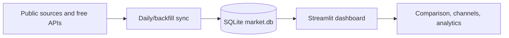

# Financial Dashboard

A local-first Streamlit market dashboard for Iranian and U.S. markets. It
stores observations in SQLite, refreshes politely once per day, and is designed
for long-horizon comparison rather than trading execution.

<!-- Screenshot placeholder: add a current dashboard screenshot here. -->

## Features

- Stocks includes the Nasdaq/NYSE directory plus a retained S&P 500 snapshot: 500 companies and
  503 share-class tickers, catalog retrieved October 9, 2026 from the
  [public constituent table](https://en.wikipedia.org/wiki/List_of_S%26P_500_companies).
  This is current membership, not a historical-membership backtest.
  Market Watch is stocks-only, with Leaderboard and Market cap views and no
  Stocks/Markets tab bar. Other instruments remain available in Charts.
  Market Watch shows Yahoo Close; charts and comparisons use Yahoo Adj Close
  (split/dividend adjusted). Yahoo's historical Close is itself split adjusted.
  Two panels below the full-width leaderboard show up to 12 top gainers and 12 top losers with logos,
  company identity and percentage changes. Independent Daily, Weekly, Monthly and
  Yearly controls sit below each heading, without pagination. The panels stack
  below the leaderboard on mobile. Calendar periods use the last
  close on or before the comparison date. Company links open their charts.
  Sector averages exclude companies listed less than five years and unknown
  listing ages. Eligibility uses Yahoo's first-trade date or matching history
  start; when only a listing year is known, year-end is used conservatively.
  The full company leaderboard uses reference-style logo/ticker rows, colored
  percentages, sorting, and 20/50/100-row pagination (20 by default) with first/previous/next/last
  controls. Company links open charts in the same tab;
  unchanged/missing changes and older-session quotes are excluded from movers.
  Compressed per-stock Parquet snapshots in `data/stocks/` keep histories small.
  Import once with `.venv/bin/python -m financial_dashboard.stocks --backfill`.
  Daily sync fetches recent missing sessions with a 14-day overlap, retries
  failures once and limits concurrency to three stocks. Changed overlap prices
  trigger a full refresh to preserve corporate-action adjustment consistency.
  Empty/failed downloads do not erase the previous snapshot.
  Market Watch has separate Markets and Stocks tabs. The stock leaderboard ranks
  annualized log-regression trends over each stock's available adjusted history,
  with market cap, sector, history dates, and Yahoo's first-trade year (not a
  verified IPO date). Daily sync refreshes metadata; viewing uses local snapshots.
  Sector averages are equal-weight company means of available annualized trends;
  they are not comparable-period sector index returns. Market Cap has five
  separate treemaps: mega ($200B+), large ($10B–under $200B), mid ($2B–under $10B),
  small ($250M–under $2B), and micro (positive caps under $250M), using the
  [J.P. Morgan size bands](https://www.chase.com/personal/investments/learning-and-insights/article/what-is-market-cap).
  Each shows up to the 50 largest companies in its band, grouped and colored by
  sector, with company names and market caps inside tiles. Figures scale
  independently; tile sizes are not comparable between figures. Missing, invalid,
  zero or negative caps are unclassified, never treated as micro-caps. All five
  sections remain visible, with explicit empty states when metadata is absent.
  The poster-style map uses locally cached logos in larger tiles; each tile
  links to its company chart. Smaller screens scroll horizontally rather than
  compressing labels into unreadable tiles. No remote images load during viewing.
  It counts each company once, not each share class. Company
  caps are not float-adjusted index weights. Logos are downloaded once from
  Financial Modeling Prep's public image endpoint and rendered from local files;
  missing logos leave the company name visible. Import with `--logos`.
  Yahoo data use/redistribution rights must be resolved before public deployment;
  this integration does not grant a redistribution license.

- Charts is the first/default page for a clean URL, with log scale and both
  regression corridor toggles initially enabled. Market Watch's latest-value cards
  read stored data only and link to detailed charts. Monthly series are labeled
  monthly; policy rates and yields show basis-point changes. Existing chart
  URLs continue to open Charts directly.

- USD/Toman, gold, silver, Bitcoin, Ethereum, BNB, S&P 500, TEDPIX, U.S. CPI, and Iran CPI.
- Commodity includes gold, silver, and Brent crude oil spot prices (USD per barrel)
  from EIA via FRED (`DCOILBRENTEU`). Oil history is stored locally; daily sync
  requests recent dates with a seven-day overlap rather than the full history.
- Oil — Brent Futures is a separate Yahoo Finance `BZ=F` daily-close series in
  USD per barrel. Daily sync stores the latest completed session, not a live
  intraday quote. Futures contract rolls can affect the history; futures are
  never appended to the Brent spot series.
- Copper uses World Bank monthly averages in USD per metric ton from 1960.
  Daily sync checks for a missing completed month before downloading the workbook.
- Broad U.S. Dollar Index uses FRED `DTWEXBGS` (January 2006 = 100), not ICE DXY.
- Market Watch's **Trend position** is the latest adjusted close's logarithmic
  residual divided by the full-history 95% regression corridor's log half-width.
  Zero is the trend, +1 the upper boundary, and -1 the lower boundary. Values can
  exceed ±1; insufficient history or zero-width corridors show a dash. It uses
  the entire stored history, independent of chart range or channel-start choices.
- **Drawdown from ATH** is `(latest adjusted close / highest stored adjusted
  close - 1) × 100`. Zero means at the closing high; negative values show the
  current decline, not maximum historical drawdown or distance from intraday highs.
- **Avg. trend deviation** is the mean absolute historical Trend position:
  `mean(abs(log(price) - fitted log trend)) / 95% corridor log half-width`.
  It uses one fixed full-history regression and equally weighted observations,
  not rolling fits. Lower values mean prices stayed closer to their trend
  relative to the corridor width; this is dimensionless, not a percentage.
- **Avg. deviation from trend (%)** is `mean(abs(price/trend - 1)) × 100`,
  using adjusted closes and one fixed full-history logarithmic regression.
  Each observation has equal weight. Unlike **Avg. trend deviation**, it is
  not normalized by corridor width. Lower means closer to trend, not necessarily
  lower daily-return volatility. Company history windows differ; compare matching
  windows for like-for-like analysis. Fewer than 30 observations shows a dash.
- **Corridor width / price (%)** is `(upper - lower) / latest adjusted close × 100`,
  using the full-history 95% corridor bounds at the latest observation date.
  This is full width, not half-width or an average across history.
- **Recent emphasis** is off by default, with a default half-life of 1 year
  (choices: 1, 3, or 6 months; 1, 2, 3, or 5 years).
  On: weights are `2^(-age in calendar years / half-life)`,
  anchored to each series' latest stored observation. The same weights apply to
  least-squares log regression, the inverse weighted-empirical-CDF corridor
  percentile, and average deviations. Annual growth, sector averages, Trend
  position and corridor width follow that fit. Off preserves equal-weight behavior.
  Drawdown, price-change cards, gainers/losers and market caps remain unchanged.
  The setting is shared across Market Watch and Charts and carried in stock links;
  Market Watch still uses full history while charts honor their Channel start.
- Charts include **Channel end**, defaulting to the latest observation. Regression,
  annual growth trend, corridor residuals and recency weights use only the selected
  start/end interval (at least 30 fit observations). Corridor lines stop at the end;
  the underlying price chart and Market Watch full-history metrics are unchanged.
  Long-range monthly fit samples retain their actual observation dates.
- The chart toolbar provides **Zoom**, **Pan**, and **Reset axes**. Switching
  tools is client-side and preserves the current viewport without rerunning
  Streamlit. Zoom remains the default drag tool; existing date bounds and
  double-click reset remain in place.
- **Observation weights** appear in a compact pane below the price chart when
  a regression fit is available, sharing its x-axis for synchronized zoom/pan.
  Values are relative to the latest training observation (100%), not normalized
  to sum to 100%. Equal weighting is flat at 100%. Historical-crossings mode
  shows the latest prediction's training window only, excluding the tested close;
  hover reports the training cutoff. The weight axis stays linear and fixed even
  when the price axis is logarithmic.
- **Volume** is available on stock and S&P 500 charts, on a separate linear
  overlay behind the price line, occupying at most the bottom 20% of the price
  plot on an independent, hidden linear volume axis. Price scaling and the
  separate observation-weights pane are unchanged. All bars sum available daily observations
  into weeks ending Friday, consistently across all chart ranges. The latest
  week may be partial. Missing observations
  remain blank, not zero. S&P 500 volume is Yahoo's reported `^GSPC` index volume,
  not ETF volume or an independently traded index. Unreported early zero values
  are omitted. Stock bars use reported share volume; colors follow the price
  direction for the displayed period. Overlays still show only the primary
  instrument's volume. The Volume toggle hides the pane without affecting prices.
  Run `python -m financial_dashboard.volume` once to backfill missing local
  `data/volumes/*.parquet` snapshots without changing stored prices. Daily stock
  updates retain Volume in stock snapshots; the daily sync separately refreshes
  S&P 500 volume with a 14-day overlap. No volume API calls occur while rendering.

### Expanding the stock catalog

`python -m financial_dashboard.listings` downloads Nasdaq Trader's public Nasdaq
and NYSE directories into `financial_dashboard/us_listings.json`. It excludes
test symbols, ETFs, preferred shares, warrants, rights, units, and debt issues.
The stored S&P 500 catalog is retained, and new directory listings are appended
without discarding existing histories. Restart Streamlit after a catalog refresh.
Missing sectors remain `Unknown` until metadata is imported.

Market-cap figures retain the five company-size bands and sector colors, with
companies nested into detailed industry groups (for example Auto Manufacturers
and Semiconductors). Industry headings appear when space allows; each tile's
tooltip includes its industry. Missing classifications are explicitly labeled.
Run `python -m financial_dashboard.industries` to save Yahoo's current industry
memberships in bulk, then fetch individual profiles only for missing labels.
The importer checkpoints completed groups and stops on provider failures;
rendering remains local. Regular metadata updates also preserve industry labels.

### Leaderboard performance

Leaderboard metrics are saved in `data/stocks/leaderboards/` for equal weighting
and each supported half-life (1/3/6 months, 1/2/3/5 years). The daily sync prepares
all eight variants after updating prices and metadata, and the existing workflow
publishes them with the stock snapshots. To prepare them manually, run
`python -m financial_dashboard.leaderboard_cache`.

Stored results include a content fingerprint of the selected stock histories,
metadata, stock catalog and calculation code. App restarts or Git checkout mtimes
don't invalidate identical inputs; changed data/code does. A missing/outdated
variant is calculated once and atomically saved, with a file lock preventing
duplicate simultaneous builds. Sector eligibility is refreshed by calendar date.
The app's memory cache uses data-version keys rather than a 15-minute expiry.

One regression fit supplies annual growth and deviation metrics for each stock.
Logo bytes are attached only after pagination/filtering chooses displayed rows.
Market-cap views read company metadata only, with no price-history or regression
work. All calculations still use full stored history; no approximation or extra
market-data request is introduced by these optimizations.
Stock chart headers also display the latest stored company market cap in USD,
with the source and retrieval date available on hover. It is not a historical
market cap for the chart's selected date range. Missing caps display Unavailable.
Company descriptions use Yahoo profiles; NIQ and Lionsgate use attributed
summaries of their official investor-relations overviews, with source links.
The additional **Industry rankings** market-cap representation shows a separate
horizontal bar chart for the industry chosen from a direct searchable dropdown,
without requiring a sector choice. Each chart ranks
up to ten largest companies across all size bands, using valid stored market caps
and the same known-share-class deduplication as the map. Bars are scaled within
each industry, not across figures, and company rows link to their stock charts.

The active universe is limited to the **2,000 largest eligible stock tickers by
market cap**, using a saved Yahoo bulk-screener ranking in
`data/stocks/universe.json`. Market Watch, chart selectors, price/metadata updates,
and volume imports use that selection; the broader exchange directory and any
previously downloaded files remain available on disk. Share-class tickers count
separately toward the 2,000-stock limit; known share classes still count once in
company market-cap figures. This is a ranking snapshot, not an automatic daily
reconstitution. Refresh it explicitly with:
`python -m financial_dashboard.stock_selection --count 2000`.
That command ranks eligible Nasdaq/NYSE tickers using paginated bulk quotes,
preserves existing company profiles, and refuses to replace a selection if too
few valid market caps are returned. Restart Streamlit after changing the selection.

After downloading the catalog, import price histories in resumable batches:
`python -m financial_dashboard.stocks --missing-only --limit 100`.
For a slower full selected-universe backfill, use
`python -m financial_dashboard.stocks --missing-only --workers 1 --pause 0.5`.
Repeat until complete; successful snapshots are retained when another ticker
fails. Run `python -m financial_dashboard.stocks --metadata --missing-only` for
missing company metadata. These network operations are separate from rendering.
The Nasdaq/NYSE catalog is now active. Without its snapshot file, the existing
S&P 500 universe remains the fallback. Price/metadata imports stop making new
requests after a Yahoo rate-limit error; rerun the missing-only commands after
the limit clears. Metadata checkpoints every 25 results and preserves completed
work on interruption. Daily sync refreshes all stock prices and rotates at most
500 stale (7-day) metadata entries; its workflow timeout is 120 minutes to allow
the larger universe. Large historical imports should run separately from the
daily job. No GitHub push is performed by a local backfill.
- **Historical crossings** is a cached expanding-window signal study with a
  separate half-life selector with the same duration choices as Recent emphasis
  (1 year by default), or equal weights. Starting after
  30 training observations, each stored close is evaluated against a weighted
  corridor predicted using strictly earlier closes. The plotted corridor is this
  sequence of out-of-sample predictions, not a final retrospective fit. Red marks
  inside-to-above exits only when the close rises from the previous observation;
  green marks inside-to-below exits only when the close falls. Flat or opposite
  price moves are excluded, including exits caused only by boundary movement. Consecutive outside
  observations and direct above-to-below flips do not repeat a marker; re-entry
  is required. The first check uses the last training close to initialize state.
  Channel start/end limit the study; Range only crops its display. Every stored
  observation is checked (monthly sources remain monthly), and every signal is
  retained in plotted prices despite display downsampling. Normal Recent emphasis
  controls are hidden (with their settings preserved) in this mode; its annual growth card uses the last prior-only
  fit. No API calls, trades, execution prices, costs, or returns are simulated.
  Stored history may contain provider revisions; point-in-time data vintages are
  not reconstructed. The mode is disabled for overlay comparisons and normal
  policy-rate views.
  **No recent emphasis** in the same selector uses equal-weight least squares
  and the ordinary interpolated residual percentile instead. The prior-only
  training, warm-up, and inside-to-outside crossing rules are unchanged.
- Stock charts show a brief extractive summary of the company's business and
  products, with the unchanged full profile in an expander. Summaries select
  business/product sentences and compact long semicolon lists, without live AI
  calls or mid-word truncation. Profiles are saved in
  `data/stocks/metadata.json` during metadata sync; chart rendering makes no
  network calls. Missing profiles are labelled, and failed/empty updates preserve
  previously stored descriptions.
  Fiserv's missing Yahoo description is supplemented from its official company
  and merchant-services pages, attributed separately in the chart view.
- U.S. Unemployment Rate uses BLS `UNRATE` via FRED: monthly, seasonally adjusted,
  U-3 unemployment in percent. Change cards show percentage-point differences.
- U.S. House Price Index uses FHFA `USSTHPI` via FRED: quarterly all-transactions
  index from 1975, not seasonally adjusted, 1980 Q1 = 100. It includes sales and
  appraisal data, not median house prices. Change cards show quarterly, yearly,
  5-year and 10-year changes. Both new series load full history initially;
  daily sync requests the last two years to capture missed releases and revisions.
  Daily updates fetch recent dates with a seven-day overlap.
- Fed Funds Target joins FRED `DFEDTAR` from September 1982 through December 15,
  2008 with `DFEDTARU` (range upper limit) from December 16, 2008 onward.
  Pre-1994 target observations are reconstructed research data. Backfill imports
  both series; daily updates continue to use only the current target-range series.
- Logarithmic charts, regression corridors, a tighter 95% corridor, annualized
  trend and R², comparison overlays, and bounded zoom.
- U.S. Treasury 2-, 10-, and 30-year daily constant-maturity yields from FRED
  (`DGS2`, `DGS10`, `DGS30`), stored in percent and displayed as estimated
  cumulative interest growth rebased to 1× at the channel start. The prior
  observation's annual yield is compounded over elapsed days / 365.25.
  This illustrative index is not a bond total-return series.
  The initial import stores full history; daily sync fetches from the latest
  stored date with a seven-day overlap. Cumulative charts start after any long
  publication gap, so the 30-year growth view starts in February 2006 without
  inventing missing yields. Log scale and regression channels are available.
- Optional drawdown, rolling volatility, and inflation-adjusted views.
- Overview cards with 1D / 1M / 1Y movement and small sparklines.
- CSV download for the current visible series and cross-market monthly-return
  correlation.
- Derived Iran series: Gold in Toman and TEDPIX in USD terms, clearly labeled
  as calculated series.

## Data sources

| Source | Series | Cadence | Caveat |
| --- | --- | --- | --- |
| Bonbast graph | USD/Toman | Daily | Public chart parser; may change without notice. |
| DataBourse | TEDPIX | Daily | Third-party public chart, not the official exchange API. |
| World Bank Pink Sheet | Gold, silver | Monthly long history | Monthly averages/fixings. |
| Alpha Vantage | Gold, silver | Daily | Free key and rate limits required. |
| Yahoo Finance | Bitcoin, Ethereum, BNB, Brent futures (`BZ=F`) | Daily | Free, no key; daily history via `yfinance`; futures are separate from spot. |
| Blockchain.com Charts API | Bitcoin before Yahoo coverage | Daily | Free market-price index; earliest values are sparse/indicative. |
| Gemini CSV archive | Ethereum before Yahoo coverage | Daily | Free, one-time historical extension. |
| Binance public API | BNB before Yahoo coverage | Daily | Free BNB/USDT candles; USDT is used as a USD proxy. |
| FRED | S&P 500, U.S. CPI | Daily / monthly | Requires a free key. |
| SCI public structured mirror | Iran CPI | Monthly | Publication lag and source revisions are possible. |
| Shiller-derived series / local SPX CSV | S&P 500 earlier history | Monthly / daily | Used only for the historical gap. |

## Architecture



## Setup

```bash
python3 -m venv .venv
.venv/bin/pip install -r requirements-dev.txt
cp .env.example .env
```

Add a free Alpha Vantage key to `.env`, then initialize the data. The initial
backfill imports World Bank Pink Sheet monthly gold and silver data from 1960,
then Alpha Vantage supplies the newer daily metal prices. Yahoo Finance supplies
the long daily history for Bitcoin, Ethereum, and BNB:

```bash
.venv/bin/python -m financial_dashboard.sync --backfill
.venv/bin/streamlit run app.py
```

## Streamlit Community Cloud

The repository includes a read-only SQLite data snapshot so the public app
starts with historical charts. On Community Cloud, use `app.py` as the
entrypoint, choose Python 3.12, and add `ALPHAVANTAGE_API_KEY` and
`FRED_API_KEY` through **App settings → Secrets**. Copy
`.streamlit/secrets.toml.example` into the Cloud secrets editor and add your
real values there; never commit them. Runtime refreshes are not durable after a
Cloud restart, so a production deployment should use an external database and
scheduled sync job.

For S&P 500 and U.S. CPI updates, add a free `FRED_API_KEY` too. The app still
runs when optional provider keys are not present; the relevant source is shown
as skipped in Data status.

Bonbast USD/Toman history does not need an API key. The initial import uses a free Bonbast-derived archive; daily values come directly from Bonbast's graph page. If a market provider key is missing, that source is skipped without preventing the other sources from updating.

## Daily updates

### Online app (GitHub Actions)

`.github/workflows/daily-prices.yml` updates the stored database daily at
**8:00 AM America/New_York**, adjusting automatically for daylight saving time
(12:00 UTC in summer, 13:00 UTC in winter). A timezone gate selects one of the
two UTC schedules; manual runs always proceed.
GitHub may start scheduled runs late; this is not a real-time price feed.

After pushing the workflow to `main`, add `FRED_API_KEY` and
`ALPHAVANTAGE_API_KEY` under **GitHub repository → Settings → Secrets and
variables → Actions → New repository secret**. Streamlit secrets are separate
and are not available to Actions. The workflow checks that both keys exist
before fetching data.

Run **Actions → Daily price update → Run workflow** for the first update.
The job commits `data/market.db` and stock snapshots in `data/stocks/`;
Streamlit Community Cloud picks up the
new repository snapshot. Successful sources are saved even if another source
fails, and the run is then marked failed so the problem is visible. Branch
protection must permit the Actions bot to push to `main`. Source publication
schedules still determine when new daily or monthly observations are available.

### Local app

Run an update manually:

```bash
.venv/bin/python -m financial_dashboard.sync --daily
```

Install the included macOS schedule (daily at 8:15 PM local time):

```bash
./scripts/install_scheduler.sh
```

Remove it with `./scripts/uninstall_scheduler.sh`. This local schedule does not
publish updates to the online app.

## Notes

- Bonbast values are stored and displayed in Toman.
- Gold and silver are USD per troy ounce. Their long-range monthly history is
  from the World Bank Pink Sheet (gold spot monthly average; silver London
  afternoon fixing); daily observations take over when Alpha Vantage data begins.
- TEDPIX is stored in index points from DataBourse's public chart page. The importer validates the embedded chart data before storing it; it is a third-party source, not the official exchange API.
- S&P 500 closes are sourced from FRED's official SP500 series. Add a free
  `FRED_API_KEY` to enable its most recent ten years of daily closing values.
  A one-time daily CSV import can fill the earlier history from 1960 through
  the day before FRED begins; the dashboard then uses FRED without overlap.
- A Shiller-derived, openly licensed monthly US-equities series remains the
  built-in fallback when a daily S&P 500 CSV has not been imported.
- U.S. Inflation uses FRED's monthly, not-seasonally-adjusted CPI-U series
  (`CPIAUCNS`) and is displayed as the conventional year-over-year percentage
  change. The raw CPI index is stored locally so a seasonally adjusted monthly
  momentum view can be added later.
- Iran Inflation uses the Statistical Center of Iran's monthly national CPI
  index via a public structured mirror. It is stored as an index level and
  displayed as cumulative inflation from the selected channel start.
- Price data is informational and may be delayed or revised by its source.
- The Bonbast collector makes low-frequency requests to the public graph page and stops on unexpected page changes.

## Development

```bash
.venv/bin/pytest -q
.venv/bin/ruff check .
```

GitHub Actions runs those checks on every push and pull request. See
[`docs/deployment.md`](docs/deployment.md) for a deployment design and the
risks of hosting public-page scrapers.
